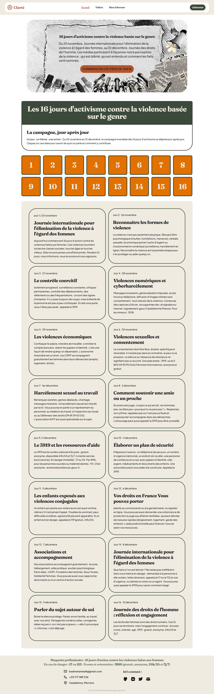
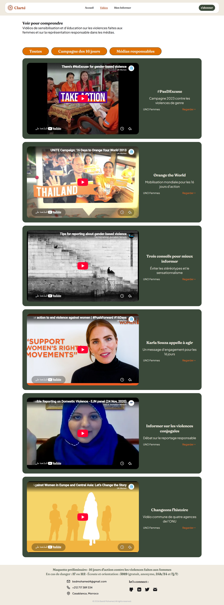
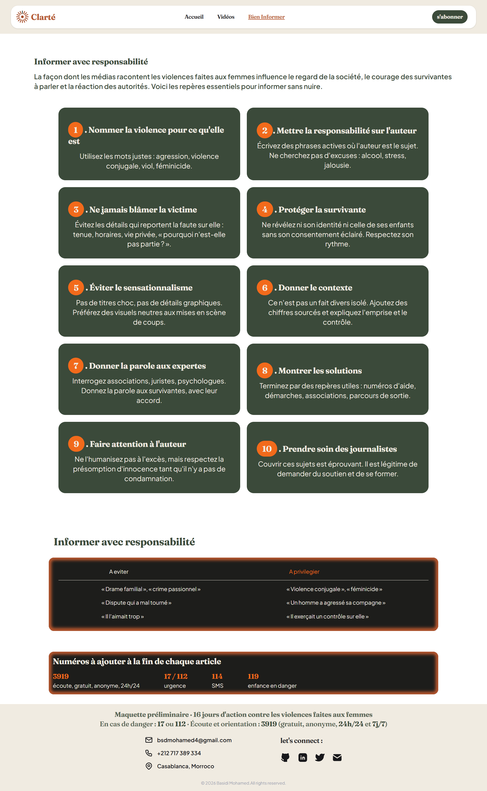
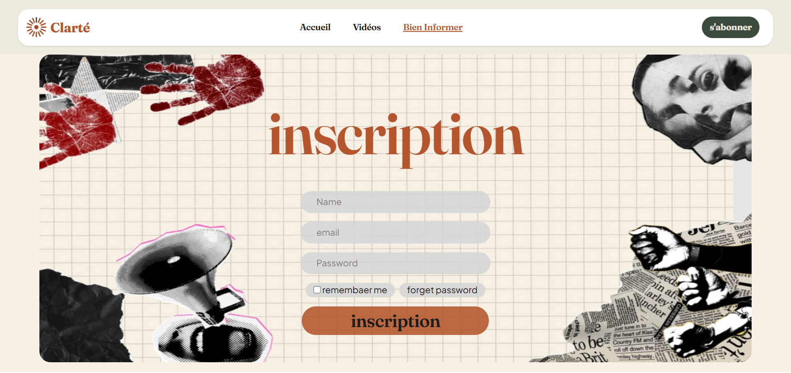
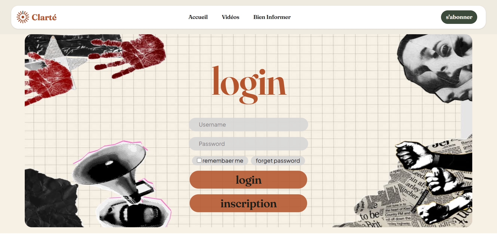

# MOAHEMED-BASIDI-final-project

## 📌 About
responsible media representation dec 8

## 🚀 Features
- Media Awareness: Raises awareness about the impact of media representation on society.
- Educational Content: Provides information and resources about responsible media practices.
- December 8 Initiative: Connects the project to the awareness and activities taking place on December 8.

## 🛠️ Technologies Used
- HTML
- Tailwind
- Css

## 📦 Installation

```bash
git clone https://github.com/username/project-name.git
cd project-name
```

Install dependencies:

```bash
# Add the installation command here
```

## ▶️ Usage

```bash
# Add the command to run the project here
```

## 📸 Screenshots

# Home page


# about page


# information page 


# login & inscription
 



## 📁 Project Structure


final-project/
├── public/
│   ├── css/
│   │   ├── index.css
│   │   ├── input.css
│   │   └── output.css
│   ├── images/
│   ├── pages/
│   │   ├── about.html
│   │   ├── informer.html
│   │   ├── inscription.html
│   │   └── login.html
│   └── videos/
├── index.html
├── package.json
├── package-lock.json
├── .gitignore
└── README.md

## 👨‍💻 Author

- MOHAMED BASIDI
- GitHub: https://github.com/MOHAMED-BASIDI
